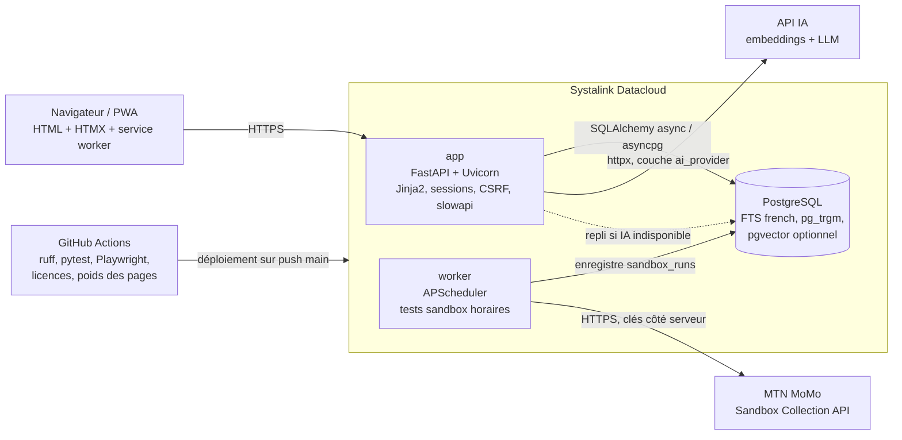
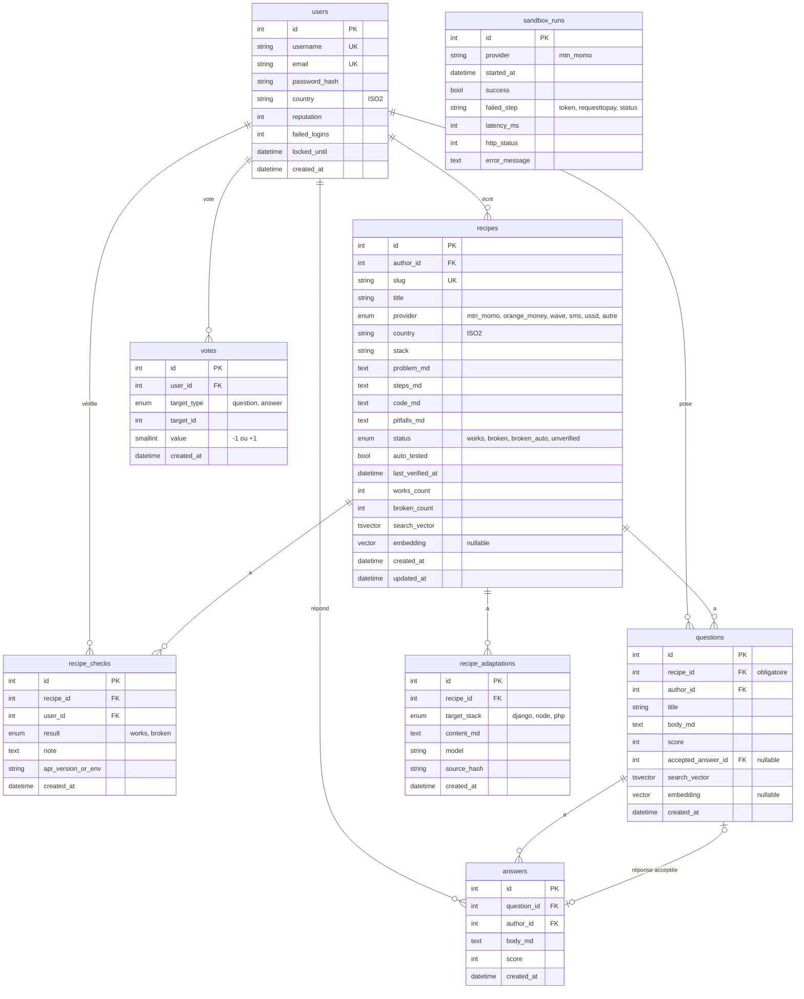

# {{NOM_PROJET}}

> **Les recettes d'intégration africaines qui marchent vraiment. Testées automatiquement, vérifiées par la communauté.**
> Projet présenté à **CADEV 2026** (Systalink) : « Construire la plateforme d'échange africaine, pour les devs, par les devs. »

[](https://github.com/{{GITHUB_ORG}}/{{NOM_DEPOT}}/actions/workflows/ci.yml)
[](LICENSE)


**Démo en ligne :** `https://{{DOMAINE}}` (TODO) · **Page de statut des API :** `https://{{DOMAINE}}/statut` (TODO) · **Vidéo :** TODO

---

## Sommaire

1. [Pitch](#1-pitch)
2. [Le problème](#2-le-problème)
3. [La solution](#3-la-solution)
4. [Fonctionnalités](#4-fonctionnalités)
5. [Architecture](#5-architecture)
6. [Stack technique et licences](#6-stack-technique-et-licences)
7. [Modèle de données](#7-modèle-de-données)
8. [Règle d'état d'une recette](#8-règle-détat-dune-recette)
9. [Installation locale](#9-installation-locale-docker-compose)
10. [Variables d'environnement](#10-variables-denvironnement)
11. [Tests et intégration continue](#11-tests-et-intégration-continue)
12. [Déploiement sur Systalink Datacloud](#12-déploiement-sur-systalink-datacloud)
13. [Sécurité](#13-sécurité)
14. [Usage de l'IA](#14-usage-de-lia)
15. [Licences](#15-licences)
16. [Feuille de route](#16-feuille-de-route)
17. [Équipe](#17-équipe)
18. [CADEV 2026](#18-cadev-2026)

---

## 1. Pitch

Un dev camerounais, sénégalais ou ivoirien qui veut intégrer **MTN MoMo**, **Orange Money** ou **Wave** passe des heures sur des tutos datés, des groupes WhatsApp et des forums où personne ne sait si la solution marche encore.

**{{NOM_PROJET}}** rassemble des **recettes** : des guides courts, avec du code, écrits par des devs africains pour des devs africains. Chaque recette porte un **badge d'état vivant** :

- les recettes **MTN MoMo** sont **rejouées automatiquement toutes les heures** contre la sandbox officielle de MTN : « ✅ Vérifié automatiquement il y a 2 h » ;
- les autres (Orange Money, Wave, SMS, USSD...) sont **confirmées par la communauté** : « Fonctionne encore » / « Cassée » ;
- une page publique **`/statut`** montre en temps réel la santé de l'API sandbox MoMo (taux de succès 24 h / 7 j, latence, dernière erreur).

Et parce qu'en Afrique la connexion n'est pas toujours garantie : **chaque page pèse moins de 50 Ko**, le site **fonctionne sans JavaScript** et s'installe comme une **application hors ligne** (PWA).

## 2. Le problème

- **Les intégrations locales sont mal documentées** : la doc officielle des opérateurs est incomplète, les exemples sont rares, et les vrais pièges (formats de numéros, devises de la sandbox, callbacks, délais) se transmettent de bouche à oreille.
- **Les tutos vieillissent sans prévenir** : une API change de version, un endpoint change, et rien n'indique que le tuto est mort.
- **Le savoir est éparpillé** dans des groupes WhatsApp et Facebook, impossible à rechercher.
- **Les plateformes internationales** (Stack Overflow, etc.) ne couvrent presque pas ces sujets, sont en anglais et sont lourdes sur une connexion 3G.

## 3. La solution

| Besoin | Réponse de {{NOM_PROJET}} |
|---|---|
| Savoir si une solution marche **aujourd'hui** | Badge d'état calculé : test sandbox automatique (MoMo) + vérifications communautaires datées |
| Trouver vite | Recherche plein texte en français + filtres fournisseur / pays / état |
| Poser une question précise | Questions-réponses **rattachées à chaque recette**, votes, réponse acceptée |
| Utiliser sa propre stack | Bouton « Adapter à ma stack » (Django, Node, PHP), clairement marqué comme non vérifié |
| Éviter les doublons | Détection de contenus similaires à la saisie (IA, avec repli sans IA) |
| Connexion faible | Pages < 50 Ko, sans JS obligatoire, PWA hors ligne, mode léger |
| Reconnaître les contributeurs | Compteur de réputation simple et classement des contributeurs par pays |

## 4. Fonctionnalités

### Recettes (cœur du produit)
- Fiche structurée : **fournisseur, pays, stack de base, problème, étapes, code, pièges** (format : [docs/RECETTE_TEMPLATE.md](docs/RECETTE_TEMPLATE.md)).
- Liste, détail, recherche plein texte (`french`) + similarité trigram, filtres par fournisseur, pays et état.
- Markdown assaini, coloration du code côté serveur (pas de JS).

### Vérification automatique MTN MoMo (sandbox)
- Un **worker** séparé exécute toutes les heures le parcours de l'API **Collection** : obtention du token, `requesttopay` avec les numéros de test documentés par MTN, puis lecture du statut.
- Chaque exécution est enregistrée (`sandbox_runs`) : succès/échec, étape en échec, latence, code HTTP, message d'erreur assaini.
- Les recettes MoMo affichent « Vérifié automatiquement il y a X h » ; un échec fait passer le badge à **« Cassée (auto) »**.
- Page publique **`/statut`** : dernière exécution, taux de succès sur 24 h et 7 jours, latence, dernière erreur.

### Vérification communautaire
- Boutons **« Fonctionne encore »** / **« Cassée »** avec une note et l'environnement testé (version d'API, stack).
- Une seule vérification active par utilisateur et par recette (la plus récente l'emporte).

### Échanges
- Questions et réponses **sous chaque recette** (pas de forum séparé).
- Votes +1 / −1 (un vote par utilisateur et par contenu), réponse acceptée par l'auteur de la question.
- **Réputation minimale** : un compteur (votes reçus + vérifications utiles), affiché sur le profil.
- **Classement des contributeurs** par réputation, filtrable par pays.

### IA utile (et limitée)
- **Doublons** : quand on rédige une question ou une recette, les contenus similaires s'affichent (embeddings ; repli automatique sur `pg_trgm` + plein texte si l'API IA est indisponible).
- **« Adapter à ma stack »** : génère une version Django, Node ou PHP de la recette, mise en cache, avec la mention **« Adaptation IA, non vérifiée par la sandbox »**.

### Accessibilité et connexion faible
- Chaque page < **50 Ko** transférés (budget vérifié en CI).
- **Fonctionne sans JavaScript** ; HTMX n'apporte que du confort.
- **PWA** : service worker écrit à la main, `manifest.json`, cache des recettes consultées, page « Hors ligne ».
- **Mode léger** : `?lite=1` + cookie, ou automatique avec l'en-tête `Save-Data`.
- Mobile-first, contrastes AA, navigation clavier, HTML sémantique.

## 5. Architecture

Un seul codebase Python, rendu côté serveur, découpé en trois conteneurs.



### Organisation du code

```
.
├── app/
│   ├── main.py              # fabrique d'application FastAPI (create_app)
│   ├── config.py            # réglages (pydantic-settings, lus depuis l'environnement)
│   ├── db.py                # moteur async, sessions
│   ├── models/              # modèles SQLAlchemy 2
│   ├── schemas/             # schémas Pydantic (formulaires, validation)
│   ├── services/            # logique métier (état des recettes, réputation, recherche)
│   ├── routes/              # routeurs HTTP (pages + fragments HTMX)
│   ├── security/            # sessions, mots de passe, CSRF, limites de débit
│   ├── ai/                  # couche ai_provider interchangeable
│   ├── sandbox/             # client MTN MoMo sandbox
│   ├── templates/           # Jinja2 (layouts, pages, partials HTMX)
│   └── static/              # CSS compilé, htmx.min.js, sw.js, manifest, icônes
├── worker/                  # point d'entrée APScheduler
├── migrations/              # Alembic
├── tests/                   # pytest (unitaires, intégration) + e2e Playwright
├── scripts/                 # import du contenu, budget de poids, contrôle des licences
├── docs/                    # RECETTE_TEMPLATE.md, notes d'architecture
├── docker-compose.yml
├── Dockerfile
└── .github/workflows/ci.yml
```

## 6. Stack technique et licences

Le règlement CADEV n'autorise que des licences permissives. **Aucune dépendance GPL, LGPL ou AGPL** n'est utilisée ; la CI échoue si une telle dépendance apparaît. C'est pour cette raison que nous n'utilisons **ni Django ni psycopg2/psycopg 3** (pilotes PostgreSQL sous LGPL) : le pilote est **asyncpg** (Apache-2.0).

| Composant | Rôle | Licence |
|---|---|---|
| Python 3.12 | Langage | PSF |
| FastAPI | Framework web | MIT |
| Starlette | Base ASGI de FastAPI, sessions | BSD-3-Clause |
| Uvicorn | Serveur ASGI | BSD-3-Clause |
| Pydantic / pydantic-settings | Validation, configuration | MIT |
| SQLAlchemy 2 (async) | ORM | MIT |
| Alembic | Migrations | MIT |
| asyncpg | Pilote PostgreSQL | Apache-2.0 |
| PostgreSQL | Base de données (FTS `french`, `pg_trgm`) | PostgreSQL License |
| pgvector (extension + client Python) | Similarité vectorielle (optionnel) | PostgreSQL License / MIT |
| Jinja2 | Templates | BSD-3-Clause |
| HTMX | Interactions sans SPA | 0BSD (BSD Zero Clause) |
| Tailwind CSS (CLI autonome) | CSS utilitaire compilé | MIT |
| markdown-it-py | Rendu Markdown | MIT |
| nh3 | Assainissement HTML | MIT |
| Pygments | Coloration du code | BSD-2-Clause |
| itsdangerous | Signature des cookies de session | BSD-3-Clause |
| pwdlib + argon2-cffi | Hachage des mots de passe (Argon2id) | MIT / MIT |
| python-multipart | Formulaires | Apache-2.0 |
| slowapi | Limitation de débit | MIT |
| APScheduler | Planification du worker | MIT |
| httpx | Client HTTP (MoMo, IA) | BSD-3-Clause |
| pytest, pytest-asyncio | Tests | MIT / Apache-2.0 |
| Playwright (Python) | Tests de bout en bout | Apache-2.0 |
| ruff | Lint et formatage | MIT |
| pip-licenses | Inventaire et contrôle des licences | MIT |
| Docker / docker compose | Conteneurs | Apache-2.0 |

> La liste complète et exacte des dépendances (y compris transitives) est générée par `pip-licenses` dans [THIRD_PARTY_LICENSES.md](THIRD_PARTY_LICENSES.md).

## 7. Modèle de données



Contraintes principales :
- `votes` : `UNIQUE(user_id, target_type, target_id)`.
- `recipe_checks` : une vérification active par `(recipe_id, user_id)` (la plus récente est prise en compte).
- `recipe_adaptations` : `UNIQUE(recipe_id, target_stack, source_hash)` ; si la recette change, son hash change et l'adaptation est régénérée.
- Index GIN sur les `search_vector`, index trigram sur les titres, index `(provider, country, status)` sur `recipes`.
- Si `pgvector` n'est pas disponible, les embeddings sont stockés en JSON et la similarité cosinus est calculée en Python sur les candidats présélectionnés par trigram.

## 8. Règle d'état d'une recette

Calculée côté serveur (`app/services/recipe_status.py`) après chaque vérification ou exécution sandbox :

1. **Recette testée automatiquement (MoMo)** : si la dernière exécution sandbox a échoué → **« Cassée (auto) »**. Si elle a réussi, `last_verified_at` = date de cette exécution.
2. **« Cassée »** si au moins **2 signalements « Cassée »** ont été faits **après la dernière confirmation**.
3. Sinon **« Fonctionne »** si une confirmation (communautaire ou sandbox) date de **moins de 90 jours**.
4. Sinon **« À re-vérifier »**.

```text
si auto_tested et dernière_exécution.échec        -> broken_auto
sinon si nb_signalements_après(dernière_confirmation) >= 2 -> broken
sinon si dernière_confirmation > maintenant - 90 j -> works
sinon                                            -> unverified
```

## 9. Installation locale (docker compose)

Prérequis : Docker et docker compose, Git.

```bash
git clone https://github.com/{{GITHUB_ORG}}/{{NOM_DEPOT}}.git
cd {{NOM_DEPOT}}
cp .env.example .env            # puis remplir les valeurs (jamais commité)
docker compose up --build -d    # lance app, worker et db
docker compose exec app alembic upgrade head
docker compose exec app python -m scripts.seed   # contenu de démonstration (optionnel)
```

- Application : http://localhost:8000
- Santé : http://localhost:8000/healthz
- Statut des API : http://localhost:8000/statut

Commandes utiles :

```bash
docker compose logs -f app worker                       # journaux
docker compose --profile dev run --rm dev pytest        # tests (image de développement)
docker compose --profile dev run --rm dev ruff check .  # lint
./scripts/get_tailwind.sh && ./bin/tailwindcss -i app/static/src/app.css -o app/static/css/app.css --minify   # build CSS
```

Sans clés MoMo, le worker démarre mais enregistre les exécutions comme « non configuré » ; sans clé IA, la détection de doublons se rabat sur la recherche trigram et l'adaptation est désactivée.

## 10. Variables d'environnement

Toutes les valeurs sensibles sont lues depuis l'environnement. **Aucune clé n'est commitée** ; `.env` est dans `.gitignore` et seul [.env.example](.env.example) est versionné.

| Variable | Obligatoire | Exemple / défaut | Description |
|---|---|---|---|
| `APP_ENV` | oui | `development` | `development`, `test` ou `production` |
| `SECRET_KEY` | oui | *(64 caractères aléatoires)* | Signature des cookies de session et des jetons CSRF |
| `DATABASE_URL` | oui | `postgresql+asyncpg://app:app@db:5432/app` | Connexion PostgreSQL (pilote asyncpg) |
| `BASE_URL` | oui | `http://localhost:8000` | URL publique (liens, cookies) |
| `ALLOWED_HOSTS` | prod | `{{DOMAINE}}` | Hôtes acceptés |
| `SESSION_COOKIE_SECURE` | prod | `true` | Cookie uniquement en HTTPS |
| `MOMO_BASE_URL` | worker | `https://sandbox.momodeveloper.mtn.com` | Base de l'API sandbox MTN MoMo |
| `MOMO_TARGET_ENV` | worker | `sandbox` | En-tête `X-Target-Environment` |
| `MOMO_COLLECTION_SUBSCRIPTION_KEY` | worker | *(secret)* | Clé d'abonnement du produit Collection (portail développeur MTN) |
| `MOMO_API_USER` | worker | *(UUID, secret)* | Identifiant API user sandbox |
| `MOMO_API_KEY` | worker | *(secret)* | Clé API associée à l'API user |
| `MOMO_CURRENCY` | worker | `EUR` | Devise acceptée par la sandbox (à vérifier dans la doc MTN) |
| `MOMO_TEST_MSISDN` | worker | `46733123455` | Numéro de test documenté par MTN (à vérifier) |
| `SANDBOX_INTERVAL_MINUTES` | non | `60` | Fréquence des tests automatiques |
| `AI_PROVIDER` | non | `none` | `none`, `mistral`, … (couche interchangeable) |
| `AI_API_KEY` | si IA | *(secret)* | Clé de l'API IA |
| `AI_BASE_URL` | si IA | — | URL de l'API IA |
| `AI_EMBEDDING_MODEL` | si IA | — | Modèle d'embeddings |
| `AI_CHAT_MODEL` | si IA | — | Modèle pour l'adaptation de stack |
| `AI_TIMEOUT_SECONDS` | non | `15` | Délai max d'un appel IA avant repli |
| `RATE_LIMIT_STORAGE_URI` | non | `memory://` | Stockage des compteurs slowapi |
| `LOG_LEVEL` | non | `INFO` | Niveau de journalisation |

## 11. Tests et intégration continue

Workflow GitHub Actions [`ci.yml`](.github/workflows/ci.yml), lancé sur chaque push et pull request :

| Étape | Outil | Échoue si… |
|---|---|---|
| Lint et format | `ruff check`, `ruff format --check` | erreur de style ou de lint |
| Tests unitaires et d'intégration | `pytest` (base PostgreSQL de service) | un test échoue |
| Tests de bout en bout | Playwright (dès la phase 7) | un parcours casse |
| Contrôle des licences | `pip-licenses` + script de garde | une dépendance GPL / LGPL / AGPL apparaît |
| Budget de poids | `scripts/page_budget.py` | une page dépasse 50 Ko transférés |
| Déploiement | job `deploy` (sur `main` uniquement) | — |

Ce qui est testé en priorité : la règle d'état des recettes, l'unicité des votes, la réputation, l'assainissement Markdown (XSS), CSRF, verrouillage après échecs de connexion, repli de l'IA, parsing des réponses sandbox (client MoMo simulé avec `httpx.MockTransport`).

**État en fin de phase 1** : les jobs `lint`, `licenses`, `test` (24 tests, base PostgreSQL 16 avec pgvector) et `budget` sont actifs ; le job `deploy` est écrit mais désactivé (voir §12). Le job Playwright s'ajoutera en phase 7, les tests métier en phases 2 à 6.

## 12. Déploiement sur Systalink Datacloud

Le projet est hébergé sur **Systalink Datacloud** ([platform.systalink.com](https://platform.systalink.com/)), conformément au règlement CADEV 2026.

- **Produit Datacloud utilisé :** `TODO` (nom exact de l'offre achetée, ressources, date d'achat).
- **Base de données :** `TODO` (PostgreSQL managé ou conteneur ; extension `pgvector` disponible : oui/non).
- **HTTPS et domaine :** `TODO`.
- **Worker :** `TODO` (second conteneur, ou plan B : APScheduler dans le processus de l'app).
- **Déploiement continu :** à chaque push sur `main`, GitHub Actions construit l'image et déploie sur Datacloud (`TODO` : méthode exacte, par exemple SSH + `docker compose pull && up -d`, webhook ou registre d'images).
- **Secrets :** stockés dans les secrets GitHub Actions et les variables d'environnement Datacloud, jamais dans le dépôt.
- **Sauvegardes :** `TODO` (fréquence et méthode de sauvegarde de la base).

## 13. Sécurité

- **Mots de passe** hachés en Argon2id (pwdlib + argon2-cffi) ; verrouillage temporaire après 5 échecs de connexion.
- **Sessions** par cookie signé (itsdangerous), `HttpOnly`, `SameSite=Lax`, `Secure` en production, rotation à la connexion.
- **CSRF** : jeton synchronisé sur tous les formulaires et requêtes HTMX non idempotentes.
- **Limitation de débit** (slowapi) sur la connexion, l'inscription, la publication, les votes, les vérifications et les appels IA.
- **Contenu utilisateur** : Markdown rendu puis assaini par nh3 (liste blanche de balises et d'attributs), liens externes en `rel="nofollow noopener"`.
- **En-têtes** : `Content-Security-Policy` stricte (pas de script inline), `X-Content-Type-Options`, `Referrer-Policy`, `Permissions-Policy`, HSTS en production.
- **Redirections** `?next=` limitées aux chemins internes.
- **Secrets** (clés MoMo, IA, `SECRET_KEY`) uniquement en variables d'environnement, jamais envoyés au navigateur, jamais journalisés ; les erreurs sandbox sont assainies avant stockage.
- **Requêtes SQL** uniquement via SQLAlchemy (paramétrées).
- **Sortie IA** : traitée comme du contenu non fiable (assainie), marquée « non vérifiée », jamais exécutée.
- **Dépendances** : versions épinglées, contrôle des licences en CI.

## 14. Usage de l'IA

Le règlement CADEV 2026 autorise l'IA à condition de la **déclarer**. Nous la déclarons ici, et le journal détaillé est tenu dans [AI_USAGE.md](AI_USAGE.md).

### Outils utilisés pendant le développement
| Outil | Usage |
|---|---|
| **Freebuff** (agent de code IA) | Génération assistée du squelette, de templates et composants frontend, de tests, et de parties du backend. TODO : préciser au fil du projet. |
| Grok Bot (assistant) | Cadrage, architecture, planning, relecture, rédaction de documentation. |
| `TODO` | … |

### Parties concernées (mis à jour à chaque phase)
| Partie | Écrit à la main | Assisté par IA | Généré par IA puis relu |
|---|---|---|---|
| Squelette FastAPI, config, Docker | | | TODO |
| Modèles et migrations | | | TODO |
| Templates et design system | | | TODO |
| Worker sandbox MoMo | | | TODO |
| Règle d'état des recettes | | | TODO |
| Tests | | | TODO |
| Contenu des recettes | TODO | | |

**Engagement :** tout code généré par l'IA est relu, testé et **compris** par l'équipe avant d'être fusionné. Les choix non triviaux sont expliqués en commentaire ou dans les descriptions de pull request.

### IA dans le produit
- **Détection de doublons** par embeddings (repli sans IA : trigram + plein texte).
- **Adaptation de recette** vers Django, Node ou PHP, mise en cache, toujours marquée « Adaptation IA, non vérifiée par la sandbox ».
- Fournisseur : `TODO` (couche `ai_provider` interchangeable, appelée via httpx). Aucune donnée personnelle n'est envoyée à l'API IA.

## 15. Licences

- **Code du projet :** licence [MIT](LICENSE).
- **Dépendances tierces :** uniquement des licences permissives (MIT, BSD, Apache-2.0, ISC, PSF, PostgreSQL License, 0BSD…). Inventaire généré : [THIRD_PARTY_LICENSES.md](THIRD_PARTY_LICENSES.md).
- **Garde en CI :** le build échoue si une dépendance GPL, LGPL ou AGPL est détectée.
- **Contenu des recettes :** `TODO` (proposition : CC BY 4.0 pour les textes, MIT pour les extraits de code).
- **Marques :** MTN MoMo, Orange Money et Wave sont des marques de leurs propriétaires respectifs ; {{NOM_PROJET}} n'est affilié à aucun opérateur.

## 16. Feuille de route

Hors périmètre du concours, planifié pour la suite :

- Recettes et questions via **WhatsApp**, **SMS** et **USSD**
- Tests automatiques sur les sandboxes **Orange Money**, **Wave** et d'autres opérateurs
- Connexion avec **GitHub**
- **Notifications** (recette cassée, réponse reçue)
- Version **anglaise** pour l'Afrique anglophone
- **API publique** des recettes et du statut
- Badges et niveaux de contributeurs

## 17. Équipe

| Membre | Rôle | GitHub |
|---|---|---|
| Lindsell Maxwell (capitaine) | Développement, architecture, design | [@Ymax27](https://github.com/Ymax27) |
| {{MEMBRE_2}} | Contenu (recettes), documentation | {{GITHUB_2}} |
| {{MEMBRE_3}} | Contenu, vidéo, campagne | {{GITHUB_3}} |
| {{MEMBRE_4}} | Tests (manuels et Playwright), qualité | {{GITHUB_4}} |

Équipe {{NOM_EQUIPE}} · Yaoundé, Cameroun 🇨🇲

## 18. CADEV 2026

Ce projet a été conçu et développé **pendant le concours CADEV 2026** organisé par **Systalink**, à partir d'un dépôt vierge, sans réutilisation de code d'un projet antérieur. Thème : *« Construire la plateforme d'échange africaine, pour les devs, par les devs. Livrez un projet utilisable et hébergé en ligne. »*

---

Fait avec soin au Cameroun, pour les devs d'Afrique.
